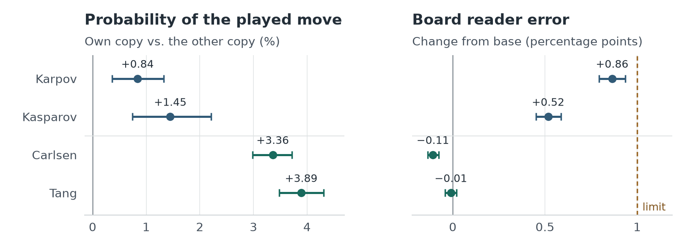
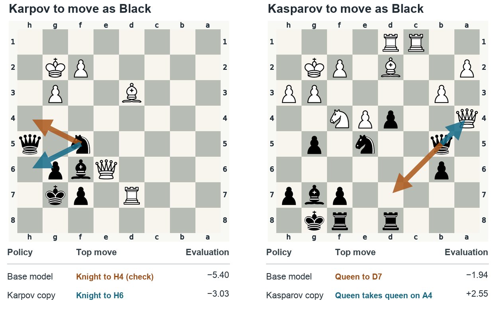
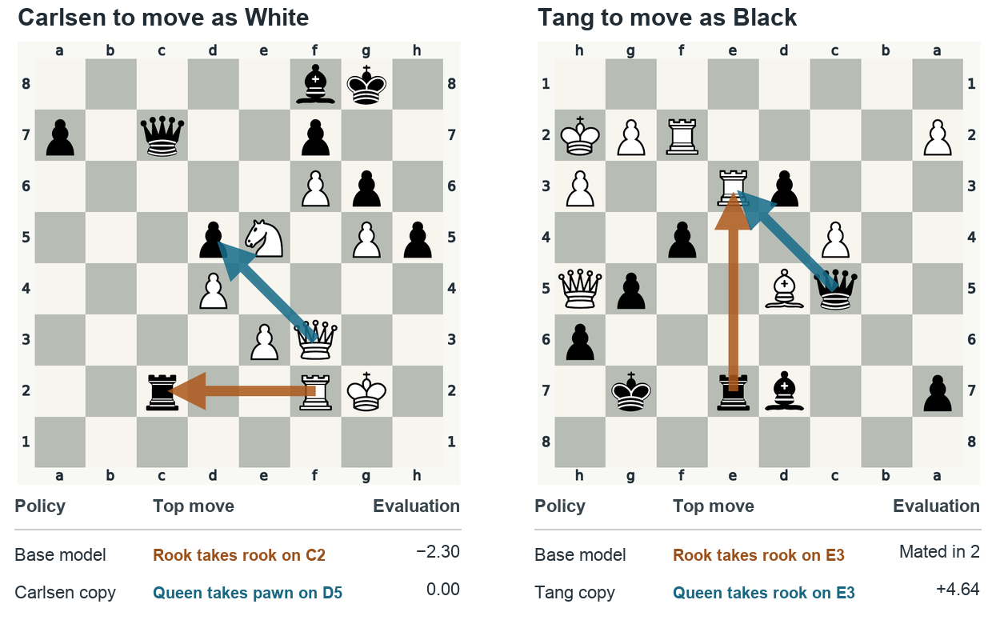
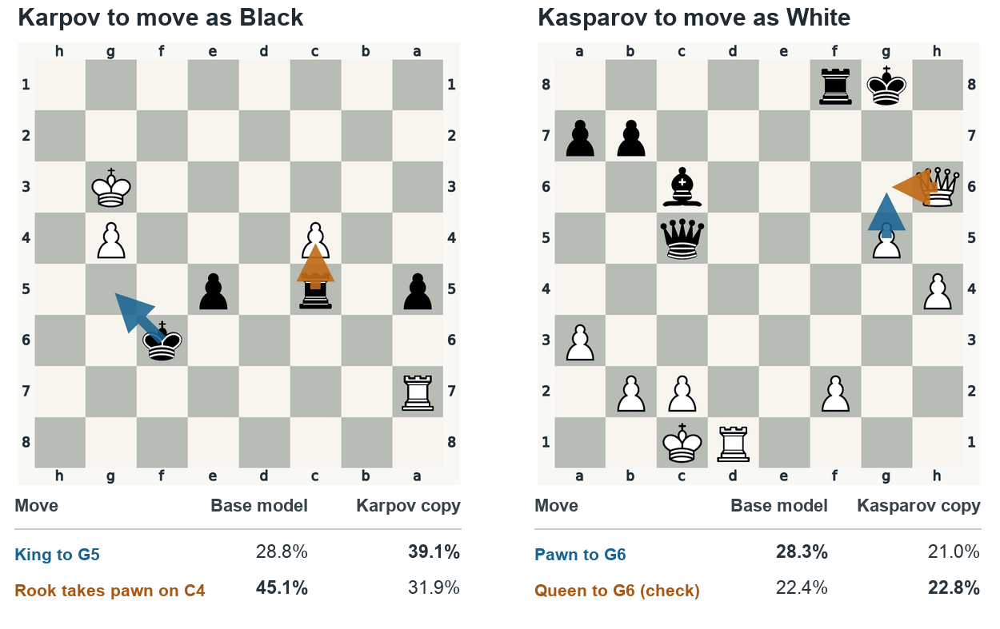
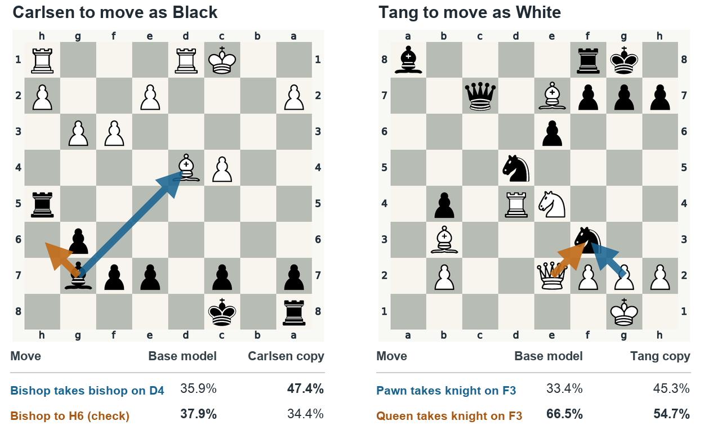
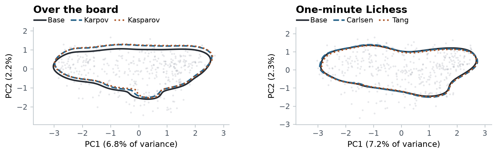

# Probing chess based World Models

If a chess model learns to prefer a different move in the same position, can the probe trained before fine-tuning still tell where its pieces are?

I fine-tuned four copies of the same chess transformer on games by Anatoly Karpov, Garry Kasparov, Magnus Carlsen, and Andrew Tang. Each specialist chose a different move from the base model on roughly **one board in six**. The frozen probe still identified pieces almost as accurately as before. The largest increase in error was **0.86 percentage points**, below the one-point tolerance I set before testing.

[Download the standalone HTML report](https://github.com/AbhayAnandUCSD/world_chess/raw/refs/heads/main/output/chess-probe-report.html) to read the full analysis and annotated positions offline.

## Five checkpoints on the same boards

The base was [Adam Karvonen’s 25M-parameter chess transformer](https://huggingface.co/adamkarvonen/chess_llms), pretrained on about 16 million Lichess games. I trained each copy on its own player’s moves. Karpov and Kasparov played in person. Carlsen and Tang’s games were online bullet, with one minute per player. I matched the amount of training text within each pair and chose checkpoints on validation games.

| Specialist | Training games | Training step | Top move differs from base | Change in probe error vs. base |
| --- | ---: | ---: | ---: | ---: |
| Karpov | 865 | 60 | 17.7% | +0.86 pp |
| Kasparov | 922 | 60 | 15.8% | +0.52 pp |
| Carlsen | 5,383 | 720 | 16.5% | −0.11 pp |
| Tang | 5,857 | 720 | 16.7% | −0.01 pp |

The move comparison uses the same 1,500 neutral positions for every model. For each pair, I trained a linear probe to identify pieces and colours from layer 6 of the base model, froze its weights, and applied it to both copies. The last column measures the change in error on **occupied squares** in that pair’s held-out games. The base error was 12.14% for the in-person games and 9.93% for bullet. The bullet copies saw about six times as many training games and trained longer, so this comparison alone cannot isolate the effect of data volume.



*Left: how much more probability each copy assigned to its own player’s recorded moves than the other copy in its pair. Right: change in board-reading error relative to the base. The intervals come from resampling games.*

## What changed in play?

Changing the player produced more disagreement than repeating training on the same player. The Karpov and Kasparov copies chose different moves on 14.2% of boards, compared with 6.1–6.5% across two runs for one player. For Carlsen and Tang, the comparison was 14.6% versus 3.0–3.5%.

The diagrams show one held-out position per player where both training seeds chose Stockfish’s best move at depth 18. Blue marks the specialist’s move and orange the base model’s. In the Karpov example, moving the knight to H6 saves it, while the base model’s check on H4 lets a pawn take it. In the Tang example, both models want the rook on E3. Capturing with the queen leaves Black’s rook on E7 to defend against mate.





These are selected examples of improvements. Across the 380 neutral boards with only one move within half a pawn of Stockfish’s best, the base found it 244 times. The specialists found it 234–243 times. Every specialist corrected some base mistakes and introduced others.

<details>
<summary>Four positions where both candidate moves were strong</summary>

To look for playing preferences, I used a different set of positions where both candidates scored within half a pawn of the engine’s best. For example, the Carlsen copy preferred trading bishops while the base preferred giving check. Stockfish separated those moves by just 0.03 pawns. The Tang example shows that a move can lose probability even when it remains the model’s first choice.





</details>

## How similar were the representations?

On the same positions, the layer-6 activations moved by about 12% of their original length (median). Positions that were close together in the base tended to stay close in each specialist: the rank correlation between pairwise distances was about 0.99 for all four. The plot shows the first two principal components, which capture about 9% of the variance.



I fitted a rotation from each specialist’s coordinates back to the base model’s and tested the frozen probe on separate games. Rotation reduced Karpov’s extra error from 0.86 to 0.29 points and Kasparov’s from 0.52 to 0.01. It barely changed Carlsen’s score and raised Tang’s from 0.01 points below the base error to 0.41 above it.

Two controls help interpret the result. On the in-person validation games, a probe trained on an untrained transformer misread 85% of occupied squares, compared with 12% on the pretrained model. And when I replaced the activations for 5% of positions with activations from another game at the same move number, error rose by 3.5 points in each pair. The test could detect a broken correspondence between an activation and its board.

I also tested whether the board information influenced a move. Making a movable piece’s square look empty inside the model reduced the probability of moving that piece by 9.5–18.5% across specialists at the medium edit strength. Random edits of the same size changed it by less than 1%. These results cover four grandmaster policies trained from a common base. A wider range of playing strengths would test whether the same probe survives larger changes in behaviour.

## Explore the experiment

| To inspect | Code | Saved evidence |
| --- | --- | --- |
| Training and checkpoint selection | [Fine-tuning](scripts/03_finetune.py), [selection](scripts/select_config.py) | [In-person configuration](configs/p1.yaml), [bullet configuration](exp_p2/configs/p2.yaml) |
| Frozen-probe transfer | [Transfer evaluation](scripts/05_probe_transfer.py) | [In-person test](results/05_probe_transfer_test.json), [bullet test](exp_p2/results/05_probe_transfer_test.json) |
| Representation alignment | [Rotation and probe refits](scripts/09_analysis.py), [geometry](scripts/11_geometry.py) | [In-person runs](results/09), [bullet runs](exp_p2/results/09) |
| Board interventions | [Causal edits](scripts/10_causal.py) | [In-person results](results/10_causal_p15.json), [bullet results](exp_p2/results/10_causal_p15.json) |
| Move preferences and game continuations | [Stockfish scoring](scripts/18c_style_engine.py), [rollouts](scripts/19_rollouts.py) | [Position analysis](results/18/style.json), [rollout results](results/19/rollouts.json) |

To regenerate the [joint comparison figure](results/figs/joint_comparison.png) from the saved results, run the following from the repository root with Python 3.12 and `uv`:

```sh
uv sync --locked
uv run python scripts/14_joint_figures.py
```

This figure uses [the saved analysis of all four specialists](results/13_joint.json), so it can be rebuilt without downloading games or training a model. The [experiment notes](WRITEUP.md) cover the data splits, checkpoint selection, training runs, and follow-up experiments.
