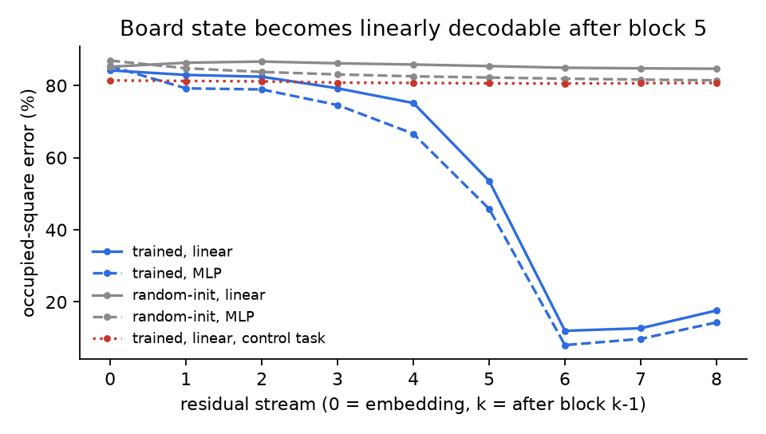
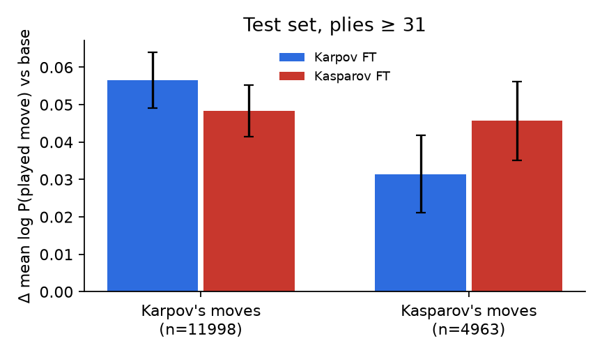
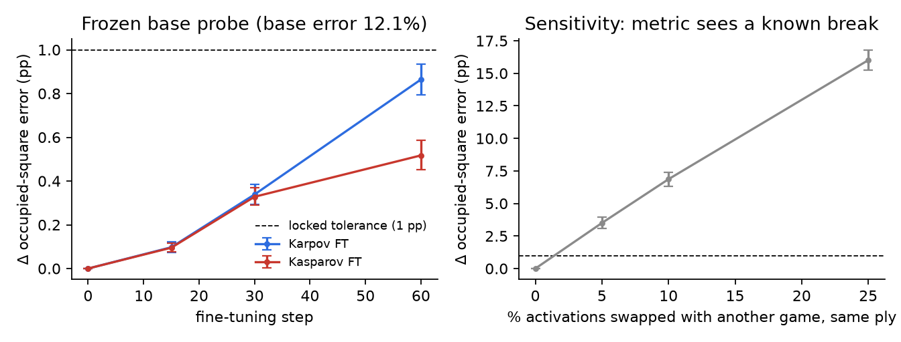
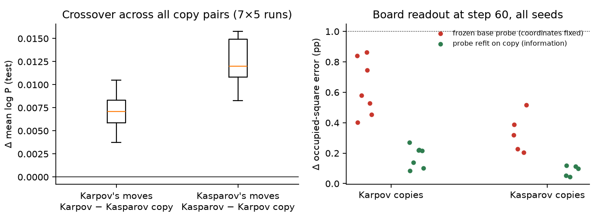
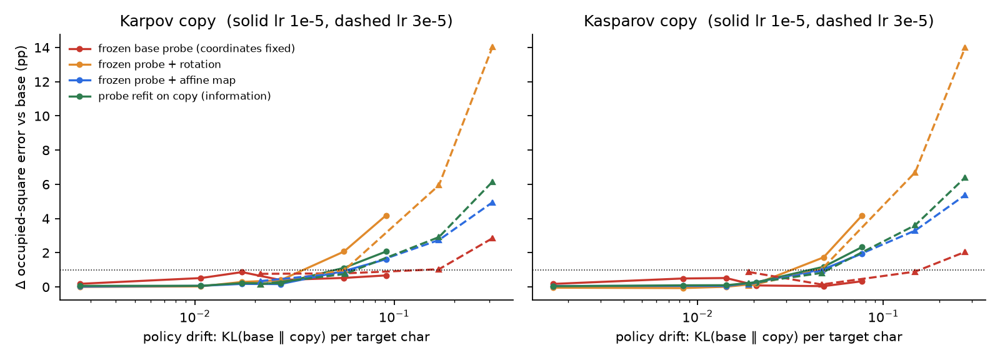
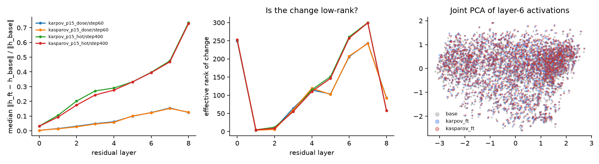

# Does player-specific fine-tuning change a chess model's moves while preserving its board representation?

*Direction 3 ("What models represent"), adapted from the **Board games** starting point. P1 pilot, one training seed.*

## 1. Question, and why it matters for world models

A world model is useful only if its internal state tracks the environment, not just its outputs. Policies are routinely specialised by fine-tuning on a narrow set of demonstrations (one user, one robot, one task). **Does that specialisation change behaviour while leaving the internal world state intact and readable by the same probe?**

Chess separates the two cleanly. Karpov and Kasparov can reasonably prefer different moves in the same position, but there is exactly one correct answer to where each piece stands. So we can (a) measure a behavioural change against a control and (b) measure the world-state representation against ground truth, in the same model, before and after.

**RQ.** After fine-tuning copies of a chess transformer on Karpov's or Kasparov's moves:
- Does each copy predict its own player better than the other copy does (a *crossover*)?
- Does a board probe trained on the base model, then frozen, still read the board from the fine-tuned copies?

**Related work.**
- **Emergent board state.** Li et al. 2023 (Othello-GPT); Nanda et al. 2023 (linear Othello representation); Karvonen 2024 (chess GPT, linear board probes ~99%).
- **Individual-player models.** McIlroy-Young et al., KDD 2022, fine-tunes Maia on single players. The nearest neighbour is *Mixture of Masters* (arXiv 2602.04447), which trains per-grandmaster GPT experts. Neither probes board state.
- **Fine-tuning tends to reuse existing mechanisms.** Jain et al. 2024; Prakash et al. 2024.
- **Probe controls.** Hewitt & Liang 2019.

We found no prior work combining a player-specific crossover with transfer of a frozen base probe.

## 2. Method

**Models**
- **Base:** Karvonen's 8-layer, 25M-parameter character-level GPT (`lichess_8layers_ckpt_no_optimizer.pt`), pretrained on ~16M Lichess games.
- **Fine-tuned copies:** two copies with all weights fine-tuned and fresh AdamW optimisers. The loss is next-character prediction, masked to **only the target player's move characters plus the trailing space**; opponent moves, move numbers and headers are input only. Both copies use identical settings, the same number of updates, and a matched target-character budget (Karpov's pool subsampled per colour to Kasparov's ~150k target characters).
- **One implementation** (a small nanoGPT re-implementation) is used for training, scoring and probing. CPU and MPS log-probs agree to 2e-4, and Mac and CUDA agree to 1e-7.

**Data**
- **Source:** PGN Mentor files for Karpov and Kasparov.
- **Filtering:**
  - Players matched on exact name variants, which fixed 9 misattributed games (e.g. a junior "Kasparov, Georgy").
  - Events kept: classical, match, rapid and blitz. Simuls, blindfold, online and vs-computer games were dropped.
- **Splits:** by whole game, stratified by player colour. Policy 70% (of which 10% is policy-dev), probe-fit 10%, probe-dev 5%, test 15%.
- **Reserved head-to-head set:** all 188 Karpov–Kasparov games.
- **Leakage control:** test or head-to-head games that near-duplicate any game in another split (same players and same first 30 plies, or prefix overlap of at least 20 plies) were quarantined (12 games).
- **Extra probe-fit pool:** 3,000 games of 8 other world champions, so the probe is player-neutral.

**Behavioural metric**
- Mean log P(recorded move), summing character log-probs including the terminating space, over plies ≥ 31.
- Game-ending moves are excluded, and all models score identical positions.
- Uncertainty: paired differences with game-level bootstrap 95% CIs.

**Board probe**
- Linear map from the residual stream to 64 squares × 13 classes, read at White-to-move `.` boundaries (Karvonen's convention), evaluated from move 16.
- Fit on the base model only, then **frozen** and applied unchanged to all copies.
- Metric: occupied-square error (wrong piece type or colour).

**Controls that make this trustworthy**

| Control | What it rules out |
|---|---|
| Random-init transformer, same probe | Probe solving the task from input statistics alone |
| Control task (Hewitt & Liang): labels a fixed random function of the last two moves × square | Probe capacity / memorisation |
| Layer sweep, linear vs MLP probe | Where the variable appears; linear vs nonlinear disagreement |
| The *other* specialist | Generic "grandmaster data" gains masquerading as player-specificity |
| Activation-swap sensitivity test (0/5/10/25%) | A preservation metric too blunt to see damage |
| Locked tolerance (1 pp occupied-square error), set before results | Moving the goalposts |
| Hyperparameters picked on dev only, with a pre-stated rule (best mean own-player dev log-prob, one shared lr and step for both players) | Test-set tuning |

## 3. First experiment: results

**Selected setting** (chosen on dev): learning rate 1e-5, early stop at step 60 of a 400-step cosine schedule, batch of 16 games. Higher learning rates or longer training overfit: train loss per character fell from 0.42 to 0.03 while dev got worse. Dropout 0.1 hurt in every configuration.

### 3a. The board is linearly decodable, and the probe reads the model, not the task

| Residual (after block) | Base, linear | Base, MLP | Random-init, linear | Control task, linear |
|---|---|---|---|---|
| 4 | 75.1% | 66.6% | 85.8% | 80.7% |
| 5 | 53.6% | 45.8% | 85.4% | 80.6% |
| **6 (frozen)** | **12.0%** | 8.0% | 84.9% | 80.5% |
| 7 | 12.7% | 9.8% | 84.8% | 80.6% |

Values are occupied-square error on probe-dev (lower is better).

- **The variable appears sharply after block 5,** matching Karvonen's layer. At layer 6, 96.0% of all squares are correct.
- **The probe reads the model, not the task.** The untrained model never gets below 85% error with a linear probe (82% with an MLP), and the control task stays at chance (≈ majority class) at every layer.
- **Linear and MLP probes disagree by about 4 pp** at layer 6, so a small part of the board is encoded nonlinearly.

### 3b. Crossover: each copy predicts its own player better (held-out test)

Mean log P(played move), plies ≥ 31:

| Model | Karpov's test moves (n = 11,998; 434 games) | Kasparov's test moves (n = 4,963; 208 games) |
|---|---:|---:|
| Base | −1.9790 | −1.9399 |
| Karpov FT | **−1.9224** | −1.9086 |
| Kasparov FT | −1.9308 | **−1.8942** |

Paired difference with game-level 95% bootstrap CI:

| | Karpov's moves | Kasparov's moves |
|---|---|---|
| Karpov FT − base | +0.057 [+0.049, +0.064] | +0.031 [+0.021, +0.042] |
| Kasparov FT − base | +0.048 [+0.041, +0.055] | +0.046 [+0.035, +0.056] |
| **Own specialist − other specialist** | **+0.0083 [+0.0036, +0.0131]** | **+0.0144 [+0.0074, +0.0219]** |
| Same, reserved head-to-head games (182 games) | +0.0150 [+0.0068, +0.0234] | +0.0104 [+0.0025, +0.0184] |

- **The crossover is present** on the test set and on the reserved head-to-head games. In those games both players face the same opponent, so the comparison has no opponent-selection confound.
- **By colour,** it holds in 3 of 4 colour cells. For Karpov as Black the CI just touches 0 (+0.0066 [−0.0007, +0.0139]).
- **Most of the gain is generic.** Both copies improve on both players by ~+0.03 to +0.06 nats per move, which is "grandmaster data" in general. The player-specific part is about 15–30% of the gain.
- **Interpretable signal.** The Kasparov copy puts relatively more probability on checking moves (−0.020 nats Karpov-minus-Kasparov on checks vs +0.003 on non-checks). This matches the raw data: after move 15, Kasparov gives check on 8.0% of his moves against Karpov's 5.9%.

### 3c. The frozen base probe still reads the board, within tolerance, but error rises with training

Occupied-square error of the frozen base probe on test: 17,478 White-to-move positions in 645 games. Base error is **12.14%**.

| Copy | Step 15 | Step 30 | **Step 60 (final)** | Within the 1 pp tolerance? |
|---|---|---|---|---|
| Karpov FT | +0.10 pp | +0.34 pp | **+0.86 pp [+0.79, +0.94]** | yes, upper bound 0.94 < 1.00 |
| Kasparov FT | +0.10 pp | +0.33 pp | **+0.52 pp [+0.45, +0.59]** | yes |

- **Sensitivity check:** swapping just 5% of activations with another game's raises error by +3.5 pp [3.1, 3.9], and 25% raises it by +16 pp. The metric clearly detects breaks well below the size of damage we care about.

**Reading.**
- **Both criteria from the pre-registered plan are met** for these checkpoints: a post-opening crossover, and a 95% upper bound on the board-error increase below the locked 1 pp tolerance.
- **The base readout does drift.** The increase is statistically nonzero and rises monotonically with training. Karpov's copy sits just inside tolerance.
- **So "preserved" here means a small, measured degradation of the original readout,** not invariance. The behavioural change and the readout drift grow together along the same training trajectory.

### 3d. Follow-up (P1.5): seeds, what the drift is, and whether the board is still *used*

**Seeds.**
- **Runs:** 7 Karpov copies (5 training seeds plus 2 alternative data subsamples) and 5 Kasparov copies. Kasparov's pool is the smaller one, so data subsamples leave it unchanged.
- **Crossover:** positive in **35 of 35** copy pairs on both players:
  - Karpov's moves: +0.004 to +0.010, mean +0.007
  - Kasparov's moves: +0.008 to +0.016, mean +0.013
- **Board error at step 60:** the frozen-probe increase stays under the 1 pp tolerance in every seed (+0.2 to +0.9 pp).

**Decomposing the drift.** For each checkpoint we compare four readouts on the same test positions:
- the frozen base probe (coordinates held fixed)
- the frozen probe after the best rotation from copy to base (orthogonal Procrustes)
- the frozen probe after the best affine map
- a probe refit on the copy with the same recipe, which measures whether the information is there at all

| Checkpoint (Karpov / Kasparov) | Policy KL from base | Frozen | Rotation | Affine | Refit |
|---|---|---|---|---|---|
| step 60 (locked) | 0.017 / 0.014 | +0.86 / +0.52 | +0.29 / +0.01 | +0.17 / +0.05 | +0.22 / +0.10 |
| step 400, same lr | 0.091 / 0.077 | +0.67 / +0.33 | +4.2 / +4.2 | +1.6 / +1.9 | +2.1 / +2.3 |
| lr 3e-5, step 400 (overfit) | 0.31 / 0.28 | +2.9 / +2.1 | +14.0 / +14.0 | +5.0 / +5.4 | +6.2 / +6.4 |

All error columns are Δ occupied-square error vs base, in pp. The refit-probe noise floor (different probe seeds on the base) is ±0.02 pp.

- **Small drift (the selected checkpoint).** Most of the frozen probe's loss is *moved coordinates*, not lost information. A refit probe is almost as good as on the base, and a rotation recovers most of the gap.
- **Large drift.** The frozen base probe holds up *better* than any whole-space alignment or refit. Geometry explains why:
  - At step 60 only 33–35% of the layer-6 change h_copy − h_base lies in the probe's dominant board directions (the top 198 singular directions, 90% of its weight), against 38.7% expected for a random direction. The fine-tune mostly moves the representation *around* the board subspace.
  - Whole-space maps are therefore dominated by large, board-irrelevant changes, which pull them off.
  - Only in the overfit run does the change start to load on board directions (45%).

**Other geometry** (layer 6, step 60):
- **Size and similarity:** the change is 12% of the activation norm, and the pairwise-distance structure is almost unchanged (RSA 0.99).
- **Not low-rank:** effective rank ≈ 207. The change is spread out and grows with depth.
- **Mostly shared:** the Karpov and Kasparov changes have cosine 0.76 between their mean deltas (0.69 per position). That is the representational counterpart of "most of the behavioural gain is generic grandmaster data".

**Causal use.** On 400 test positions, we edited the layer-6 residual at the move boundary along the frozen probe's direction so the probe reads one White piece's square as empty. We then measured the drop in probability mass on that piece's legal moves:

| Model | Weak / medium / strong edit | Random direction, same norm |
|---|---|---|
| Base | 6.1% / 18.7% / 43.6% | −0.3% / −0.3% / 0.0% |
| Karpov copy, step 60 | 5.7% / 18.5% / 44.4% | about 0 |
| Kasparov copy, step 60 | 5.4% / 17.2% / 40.4% | about 0 |

- **The copies use the base's board direction exactly as the base does,** so the board is not just decodable but still causally used.
- **The overfit copies are *more* sensitive** to the edit (11–18% / 28–33% / 48–54%).

**Revised reading.** Player-specific fine-tuning at the selected checkpoint:
- changes behaviour reliably (crossover in every seed)
- leaves board information intact (refit ≈ base)
- leaves its causal role intact (identical edit response)

What drifts is mainly the *coordinate frame*, and the drift largely avoids the board subspace. Tools built on the base model (probes, monitors) therefore degrade gracefully for this kind of specialisation. Pushed into overfitting, the representation starts to change in board directions too.

### 3e. Second pair (P2): Carlsen vs Tang, Lichess 1+0 bullet, ~5.4k games per copy

Identical pipeline. Rated 1+0 games from June 2017 on (none from the base model's training months). A move is dropped if the mover had under 10 s left. Head-to-head games are reserved. Learning rate 3e-6 and step 720 were picked on dev data only. The probe was refit on Lichess and OTB positions that exclude both players; base error is 9.93%. Figures are in `exp_p2/results/figs/`; the joint figure is `results/figs/joint_comparison.png`.

| Own copy − other copy | Carlsen's moves | Tang's moves |
|---|---|---|
| Test (95% CI) | +0.033 [+0.029, +0.037] | +0.038 [+0.034, +0.042] |
| Head-to-head | +0.031 | +0.026 |
| 30 seed pairs | +0.033 to +0.035 | +0.038 to +0.041 |

- **Crossover is about 3× P1's**, and it holds in every seed pair.
- **Frozen-probe drift at step 720** is −0.11 / −0.01 pp, and all seeds are within −0.15 to +0.07 pp. The sensitivity check still detects a real break (5% swap → +3.5 pp).
- **Drift is a transient bump.** Frozen-probe error peaks at +0.39 / +0.28 pp around steps 60–100 and returns to about 0 by step 400–720; rotation and refit stay about 0 throughout. At the hot lr of 3e-5 it peaks at +0.86 / +1.07 pp, then falls back. Late on, a fitted rotation is *worse* than the frozen probe (Tang: +0.4 pp), because there is nothing left to undo.
- **Geometry and causal use match P1.** At layer 6, CKA is 0.996 and RSA 0.99. 33–36% of the change lies in the probe's top directions, vs 40% for a random subspace. Probe-direction edits drop probability on the edited piece's moves by about the same amount in the base and the copies: 30.7 / 31.3 / 28.1% at margin 25 for base / Carlsen copy / Tang copy, vs ≤1.4% for a random direction.

### 3f. Both pairs together (base + 4 copies)

- **Each copy is best on its own player, but most of what it learns is the domain.** The Kasparov copy gains +0.048 on Karpov's moves, against +0.057 for the Karpov copy. Gains across domains are small: ≤ +0.007 for P1 copies on bullet moves, +0.005 to +0.024 for P2 copies on OTB moves.
- **The copies' changes share a direction.** The cosine between their mean layer-6 changes is 0.77–0.78 within a pair and 0.56–0.61 across pairs. That fits a shared "human GM" part, plus a domain part, plus a smaller player part.
- **The domain-shift explanation for P1's drift is only partly right.**
  - All copies drift more on OTB positions: P2 copies +0.17 / +0.26 pp there vs about 0 on Lichess.
  - But P1 copies also drift on Lichess positions (+0.39 / +0.15 pp).
  - P1's checkpoint (step 60) lands where P2 shows its transient bump.
  - Resolved in §3g: at matched KL the pairs are identical.
- **Absolute probe error depends on the probe's training pool.** P2's probe reads P1's positions at 9.3% error, vs 12.1% for P1's own probe. Only differences from the base under the same probe are compared.

### 3g. Matched policy shift: one curve for all four copies

Every training checkpoint of all four copies was re-scored on both position types (OTB with the P1 probe, Lichess with the P2 probe), with KL(base‖copy) measured on the same positions (`scripts/16_matched_kl.py`, `results/figs/matched_kl.png`).
- **At equal KL, all four copies drift the same.** At KL 0.01 the frozen probe is +0.4 to +0.5 pp on OTB positions and +0.2 to +0.3 pp on Lichess positions, for every copy. Drift is set by policy shift and measurement domain, not by the pair.
- **P1 looked worse because of where it was stopped.** Its checkpoint (KL ≈ 0.015) sits on the early bump; P2's checkpoint is past it. This resolves §3f.
- **Information loss (refit) begins beyond KL ≈ 0.04, on a shared curve.** With ~5k games, P2's copies stay below KL 0.07 even at lr 3e-5 (refit ≤ +0.5 pp). With ~1k games, P1's copies reach KL 0.3 (refit +5 to +6 pp).

### 3h. Playing style: what differs between the copies

Setup (`scripts/17_identify.py`, `18*_style*.py`, `results/figs/style.png`): 7,300 positions, the same for every model:
- 1,500 neutral OTB positions (games with none of the four players)
- 1,000 positions from Carlsen–Tang games
- 1,200 positions from each player's own test games

For each position I took every model's probability over all legal moves. From that come expected move habits plus Stockfish 17 measures: centipawn loss, top-move rate, blunders, and "leaves the opponent one good reply".
- **Who played?** From a whole game, the copies identify the player with AUC 0.76 for Carlsen/Tang (68% correct) and 0.63 for Karpov/Kasparov.
- **Top-move disagreement beyond seed noise.** The two players' copies disagree on the top move in ~14.5% of neutral positions. Two seeds of the same player disagree in only 3.5–6.5%.
- **The shared shift follows the domain.** OTB copies play more cautiously: fewer captures, trades, checks, and moves into the opponent's half. They are also slightly less accurate by Stockfish. Bullet-pro copies get more accurate: −5 cp loss, fewer blunders.
- **Small per-move gaps compound.** At 14.5% top-move disagreement, and treating each position as independent, two copies play the same first 20 of their own moves only ~4% of the time. Compounding also amplifies noise, though: two same-player seeds (3.5%) match only ~50% of the time. So the evidence for style is the per-position gap over the seed baseline, not the divergence of whole games. §3i measures the divergence directly with rollouts.
- **The player-specific part points the way the real players differ.** Over 8 habits, r = 0.85 for Carlsen–Tang and 0.66 for Karpov–Kasparov. Example: Carlsen captures, trades and pushes into the opponent's half more than Tang, and his copy does too, at about half the size.

### 3i. Rollouts: do small per-move differences add up to different games?

Setup (`scripts/19_rollouts.py`, `19b_rollout_analysis.py`, `results/figs/rollouts.png`):
- **Starts:** 600 shared positions (300 neutral OTB, 300 Carlsen–Tang), all from move 16 on.
- **Players:** each model plays the side to move against the greedy base model, greedily, for 30 plies. Because the opponent is fixed, two games can only split on the tested model's own move.
- **Comparisons:** only fair pairs. Within a pair, same-player seeds, and copy vs base; P1 is never compared against P2.

| Pair | First move differs | Identical after 10 own moves | Squares different at ply 30 |
|---|---|---|---|
| Same player, two seeds (Karpov / Kasparov) | 6.3% / 5.8% | 54% / 58% | 7.1 / 6.4 |
| Same player, two seeds (Carlsen / Tang) | 2.3% / 2.3% | 71% / 73% | 4.6 / 4.5 |
| Karpov vs Kasparov copy | 12.3% | 32% | 10.5 |
| Carlsen vs Tang copy | 13.0% | 29% | 10.8 |
| Copy vs base | 13–15% | 21–24% | 11.5–12.0 |

- **Players split far more than seeds.** The two players' copies diverge much more often than two seeds of one player. The gap is 42 points for P2 and 24 for P1, and it replicates with the seed-1 copies.
- **One split means a different game.** Once games split, the boards differ on ~12–13 of 64 squares by ply 30, whatever caused the split. Player style changes how often games split, not how far apart they end up.
- **Shared part, then player part.** Copies are closer to each other than to the base: both move away from the base first (the shared domain part), then apart from each other (the player part).

## 4. What would change the conclusion, and what we'd run next week

**What would change the conclusion**
- **Seeds:** the crossover vanishes or flips sign under different training seeds or data subsamples. This has now been checked: it survives 35 of 35 seed pairs, but the effect is small, about +0.01 nats per move.
- **Matched-probe refit:** a probe refit on each fine-tuned copy recovers no better than the frozen one. That would mean the board information itself, not just the readout's alignment, is being lost.
- **Causal use:** probe-direction interventions change the base model's moves but not the fine-tuned copies'. The board would still be decodable but no longer used, which would turn "preserved" into "preserved but bypassed".
- **Longer or stronger training** pushes the board-error increase past tolerance *before* the crossover gets larger. That would mean specialisation and world-state preservation trade off.

**Next week** (items 1–3 are done; see §3d)
1. ~~Robustness across seeds and data subsamples~~ (done: crossover in 35 of 35 pairs).
2. ~~Matched probe refit~~ (done: information preserved at the locked checkpoint).
3. ~~Causal check~~ (done: identical edit response in base and copies).
4. **More policy shift with more data.** P2 done (§3e–f): with 5× the data, crossover is ~3× larger and the board probe still holds. Our ~1–2k games per player are 0.01% of pretraining. Test the same question where the policy can move further:
   - prolific Lichess players (50k+ games each, via the public export API)
   - a "positional school" vs "dynamic school" built by pooling several grandmasters
   - human vs Stockfish games, using Karvonen's released datasets
5. **Trade-off curve:** run higher learning rates or longer training deliberately (the overfitting regime), and plot crossover size against board-error increase along the trajectory.
6. **Model diffing:** use Karvonen's released chess SAEs, or crosscoders, to find which features the fine-tune changes, and whether they are board features or move-preference features.

## 5. What I'd want to work on with you

*(to be written by Abhay)*

---

**Reproduce:** `uv sync`, then:
- `scripts/01_data.py`
- `scripts/run_p1.sh 0 1 2`: probe refit, sweep, selection
- `scripts/run_p1_final.sh 0 1 2`: final fine-tunes and evals
- `scripts/08_figures.py`

The viewer is `uv run python -m viewer` (localhost:8765). W&B project: `world-model-internal`. Settings are in `configs/p1.yaml`, with lr and steps locked by `scripts/select_config.py`.
