# Fine-tuning chess models across Elo bands

I expected a wider rating gap to produce a larger policy difference than the grandmaster pairs. The low- and high-Elo copies chose different moves on **12.3% of the same 1,500 neutral boards**, compared with **14.2% for Karpov–Kasparov and 14.6% for Carlsen–Tang**. This is well above the **3.3–3.7%** difference between two seeds trained on the same Elo band. The frozen probe continued to read the board within the original one-percentage-point tolerance.

## Data and controls

The low band contains games with both players rated 1500–1999. The high band requires both players to be rated at least 2300. Each pool has 100,000 Lichess games from August–October 2017, with the time-control distribution matched across bands. After account-grouped splitting, the policy pools contain 70,000 low-band and 70,148 high-band games. The audit confirmed zero target-player account overlap between policy training and test in both bands. Eighteen games labelled test_leak are excluded from the test split.

The inherited 3,000-game extra probe-fit pool includes some online events and is treated as mixed-source.

The shared setting was chosen on development games after learning-rate and batch-size/weight-decay sweeps. Both copies used learning rate 3e-6, batch size 16, weight decay 0.1 and 6,000 updates. This matches sampled-game updates; target-character totals can still differ because game lengths differ. The study also saved five training seeds per band, two data-subsample runs per band, and higher-learning-rate trajectories. Identical low-band subsamples were deduplicated in the robustness comparison, leaving five distinct low runs and seven high runs.

For the behavioural comparison, I reused the exact grandmaster evaluation positions and engine scores: 1,500 neutral champion-game boards and 1,000 Carlsen–Tang positions. I additionally sampled 1,200 held-out positions from each Elo band. Legal moves were scored with the same character-level likelihood and trailing-space convention. Stockfish used depth 12 for move scores and depth 8 for reply pressure. Confidence intervals below resample whole games.

These rating bands label the training data. The experiment did not measure a playing Elo for the fine-tuned models. A shared pretrained model and the overlap in reasonable moves across these rating bands could explain the modest separation, but this experiment does not isolate either explanation.

## Policy difference on identical boards

| Comparison | Different top move on 1,500 neutral boards |
|---|---:|
| Karpov vs Kasparov | 14.2% |
| Carlsen vs Tang | 14.6% |
| Low vs high Elo, seed 0 | 12.3% |
| Low vs high Elo, seed 1 | 12.5% |
| Low Elo, two seeds | 3.7% |
| High Elo, two seeds | 3.3% |
| Low Elo vs base | 8.8% |
| High Elo vs base | 13.0% |

On the 1,000 shared bullet positions, the Elo copies disagree on 11.5% of moves, versus 2.6–2.7% across seeds. On their respective held-out Elo positions, disagreement is 13.0% for the low-band set and 12.4% for the high-band set.

The low-band copy gave its own band’s held-out moves **+0.0297 nats per move** more probability in log space than the high-band copy (95% interval +0.0286 to +0.0309). The high-band copy’s own-band advantage was **+0.0261** (+0.0251 to +0.0270). Both directions were positive in all 35 pairings of the distinct training runs.

The model scores identify the Elo band of a held-out game with **AUC 0.732**, using the target player’s moves after move 15. The corresponding earlier results were approximately 0.63 for Karpov–Kasparov and 0.76 for Carlsen–Tang. Using up to ten scored moves, Elo AUC was 0.685. This establishes rating-specific prediction preferences.

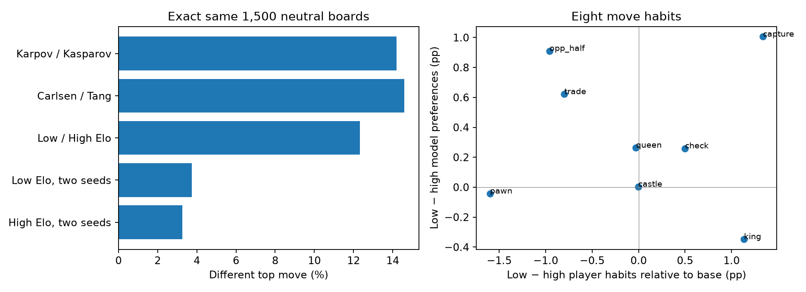

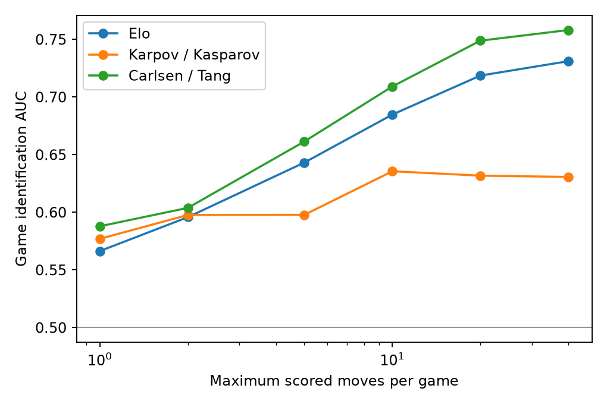

The Elo-minus-Karpov–Kasparov disagreement difference is −1.87 percentage points (paired game-bootstrap 95% interval −3.99 to +0.14); Elo-minus-Carlsen–Tang is −2.27 points (−4.36 to −0.20).

The eight-habit comparison gives a different result. The correlation between the models’ low-minus-high preferences and the human low-minus-high tendencies relative to the base is **r = -0.026**, compared with 0.66 and 0.85 in the grandmaster pairs. Thus, this particular habit summary does not reproduce the grandmaster result. Elo specialization is supported by move prediction and game identification; broad claims about learned human playing style would exceed this evidence.

## Move quality

| Model | Sole near-best move found, out of 380 | Mean top-move loss, centipawns | Expected loss under legal-move probabilities, centipawns |
|---|---:|---:|---:|
| Base | 244 | 65.79 | 103.81 |
| Low Elo | 245 | 66.04 | 101.79 |
| High Elo | 251 | 63.61 | 98.90 |

The high-Elo copy assigned less probability to poor moves. Its expected centipawn loss was 4.91 lower than the base (95% interval 4.04 to 5.84 lower), and its probability of choosing a move at least 200 centipawns below the engine’s best was 0.93 percentage points lower.

For the greedy top move, the high-Elo change was −2.18 centipawns (95% interval −5.71 to +1.23). Its seven extra successes on the 380 sole-near-best positions correspond to +1.84 percentage points (−0.52 to +4.01). Those intervals include zero. The probability distribution improves more clearly than these top-choice measures. These are depth-limited engine evaluations on the shared board set, rather than a measured playing rating.

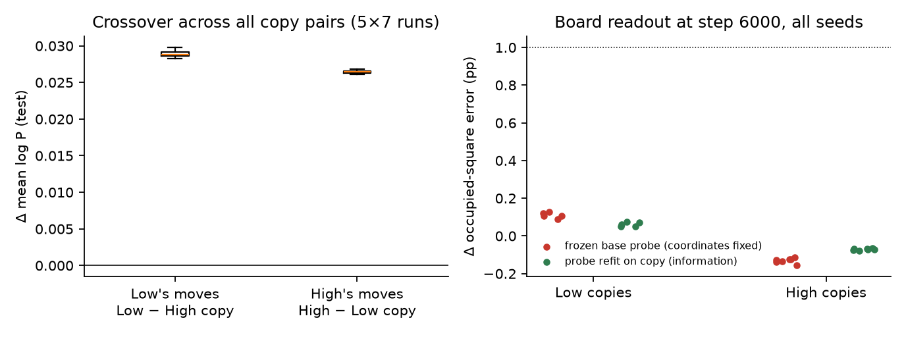

## Frozen probe and representation

The Elo experiment fitted its own base probe, using the same layer-6 linear recipe with its larger probe-fit pool. On 741,106 held-out positions from 29,001 games, occupied-square error was **4.143% for the base, 4.250% for the low-Elo copy and 4.018% for the high-Elo copy**. Their changes were +0.107 points (95% interval +0.100 to +0.114) and −0.125 points (−0.133 to −0.118). Both stayed within the prespecified one-point tolerance, including the checked intermediate checkpoints at the selected learning rate.

Absolute error rates here use a different probe-fit pool and evaluation set from P1 and P2. The shared-domain comparison below applies the original grandmaster probes to the Elo checkpoints on the original grandmaster test positions. At the selected Elo checkpoints, the original P1 probe changes by −0.171 points for low Elo and −0.228 for high Elo; the original P2 probe changes by −0.134 and −0.341 points. Preservation therefore also holds with the earlier probes and domains.

The higher-learning-rate runs do not always preserve the frozen probe: peak extra error reaches 1.64 points for low Elo and 1.09 for high Elo on the Elo test set. Refitting reduces those peaks to 0.64 and 0.55 points, respectively. Preservation is therefore a result for the selected training regime, not a guarantee under further training.

The random-label and untrained-model controls were rerun. Replacing activations for 5% of validation positions with another game’s activations raised error by 3.74 points, so the preservation test remained sensitive to wrong boards.

At the selected checkpoints, refitting the probe left changes of +0.070 points for low Elo and −0.070 for high Elo. Rotating activations back to the base increased error to +0.328 and +0.219 points. A rotation therefore offered no improvement at these selected checkpoints. Their board representations were already readable using the frozen probe.

At layer 6, median relative activation changes were 8.8% for low Elo and 11.5% for high Elo. Pairwise geometry stayed similar to the base (rank correlations 0.993 and 0.988). The fractions of activation-change energy in the probe subspace were 46.4% and 39.3%, against a 44.9% random-subspace expectation. The earlier pattern of changes avoiding the probe subspace does not hold uniformly for this pair.

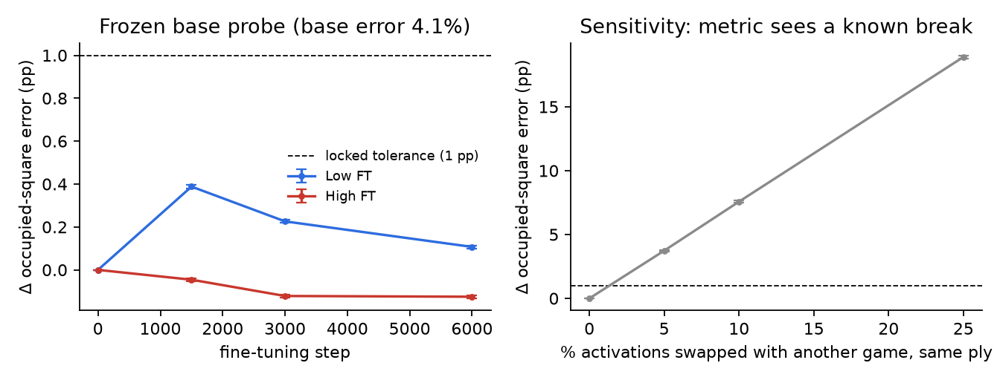

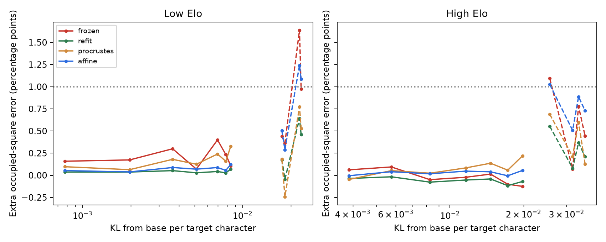

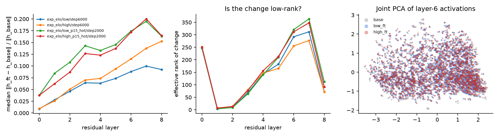

## Matched policy shift across all six copies

I evaluated both Elo trajectories on the original P1 and P2 position sets with each set’s original frozen probe and probe-fitting recipe. The solid curves use the selected learning rate; dashed curves use the higher learning rate. Each comparison of models within a panel therefore shares its board positions, probe and definition of policy KL. Interpolated matched-KL values are reported only within the observed trajectory range.

At matched KL 0.01, the high-Elo copy has interpolated frozen-probe drift of **+0.113 points on the in-person domain and −0.056 on the bullet domain**. The grandmaster copies span +0.387 to +0.518 and +0.171 to +0.264, respectively. The Elo curves therefore do not collapse onto the earlier grandmaster curves. Policy KL alone is insufficient to predict probe drift across these experiments. The selected-learning-rate low-Elo trajectory never reaches KL 0.01 on either shared domain, so I do not extrapolate a value for it.

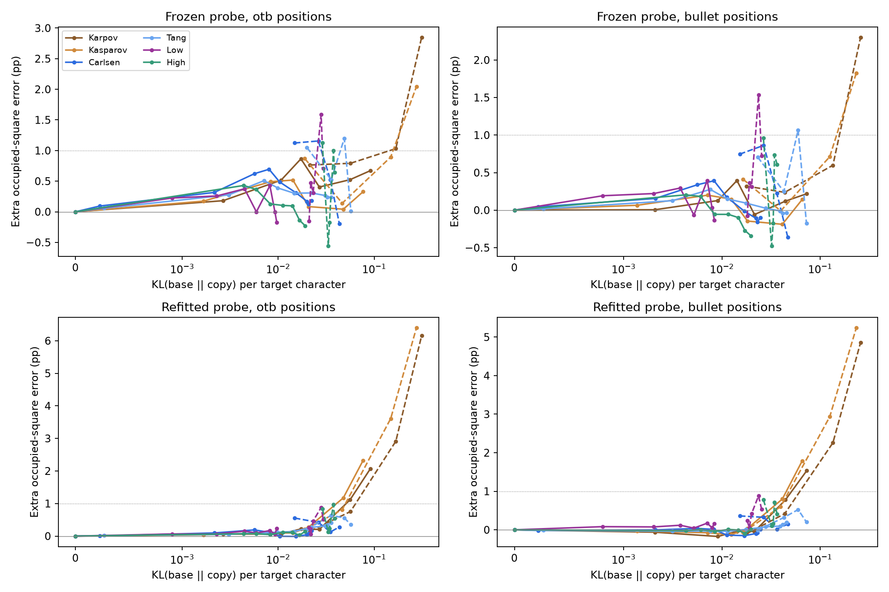

| Position domain | Specialist | Frozen extra error at KL 0.01 | Refitted extra error at KL 0.01 |
|---|---|---:|---:|
| otb | Karpov | +0.486 pp | +0.064 pp |
| otb | Kasparov | +0.499 pp | +0.093 pp |
| otb | Carlsen | +0.518 pp | +0.012 pp |
| otb | Tang | +0.387 pp | +0.119 pp |
| otb | High | +0.113 pp | +0.088 pp |
| bullet | Karpov | +0.175 pp | -0.149 pp |
| bullet | Kasparov | +0.171 pp | -0.103 pp |
| bullet | Carlsen | +0.264 pp | -0.076 pp |
| bullet | Tang | +0.194 pp | -0.036 pp |
| bullet | High | -0.056 pp | -0.017 pp |

## Does the board signal still affect moves?

On 400 positions, a medium-strength probe-direction edit toward an empty square reduced probability assigned to the selected piece’s legal moves by **7.82% in the base, 8.39% in the low-Elo copy and 8.16% in the high-Elo copy**. Equal-size random edits changed it by about 0.48–0.56%. The readable board signal continued to influence move predictions.

## Do the differences compound through games?

All five models played from the same 600 starts used for the grandmaster comparison, for up to 30 plies against a greedy base-model opponent. I used the same context-length and game-ending rules, and compared only eligible sequences at each move count.

| Comparison | Games still identical after ten own moves |
|---|---:|
| Karpov vs Kasparov | 32% |
| Carlsen vs Tang | 29% |
| Low vs high Elo | 28.3% |
| Low Elo, two seeds | 75.3% |
| High Elo, two seeds | 72.1% |

For low vs high Elo, 543 paired games reached 30 plies. Their final boards differed on an average of 10.7 squares. The curves below preserve the same eligibility convention as the earlier report. Repeating the base rollout reproduced 594 of the 600 historical sequences exactly; six differed under the new inference batching, so exact rollout percentages have some numerical sensitivity.

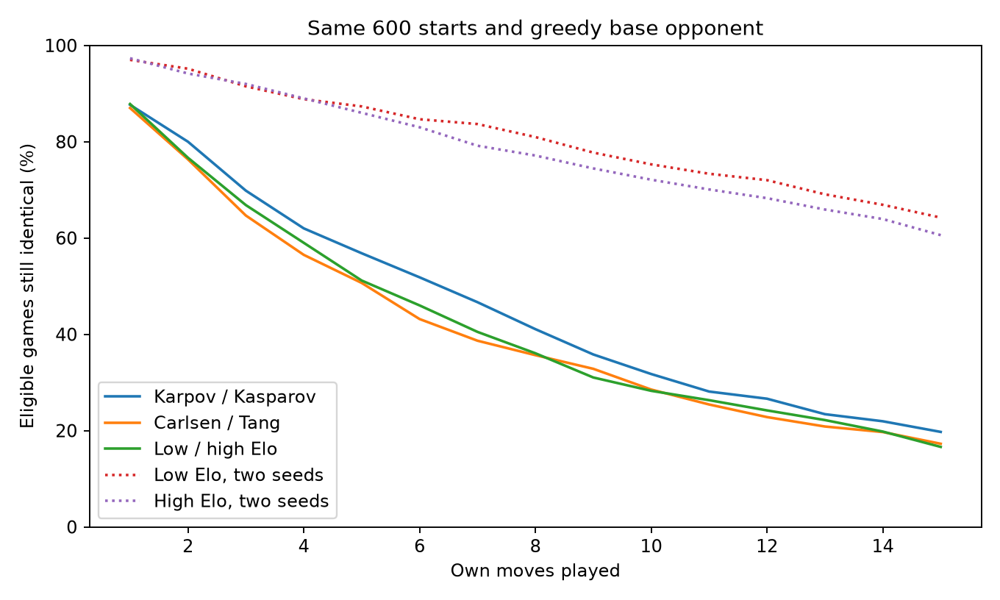

## What this changes in the conclusion

The test across Elo bands supports frozen-probe transfer under a further form of specialization. It also revises my expectation that this rating gap would necessarily produce a larger policy difference than individual grandmaster styles. On the shared neutral boards, the Elo copies disagreed slightly less often.

The evidence supports different move preferences, preserved board readability, and continued influence of the board signal. The eight-habit style result and greedy move-quality results are more limited. A stronger test of the pretraining explanation would vary fine-tuning strength and data while holding evaluation positions fixed, and measure the resulting models’ playing strength directly.

## Selected move changes

These positions were selected after the aggregate evaluation to illustrate both improvements and regressions. Both training seeds made the specialist choice in each example. Depth-18 checks compare the base and specialist candidates. Blue marks the specialist move and orange the base move; scores are from the side to move.

**Low Elo, Black to move.** Base chose rook from B8 to H8 (-6.76 pawns); the specialist chose knight from D7 to C5 (+2.23 pawns).

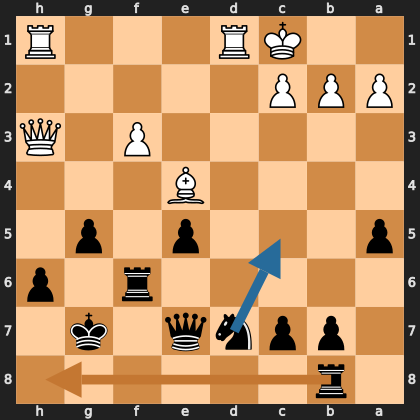

**Low Elo, Black to move.** Base chose queen from E6 to E5 (-2.99 pawns); the specialist chose knight from G6 to E5 (gets mated in 1).

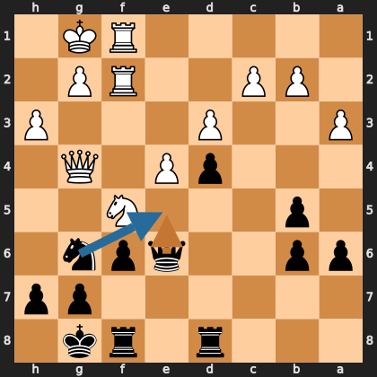

**High Elo, White to move.** Base chose bishop from E4 to C6 (gets mated in 1); the specialist chose pawn from F2 to F3 (+0.87 pawns).

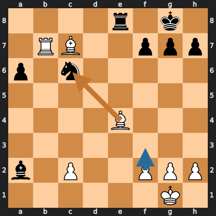

**High Elo, Black to move.** Base chose queen from F3 to F1 (+8.04 pawns); the specialist chose queen from F3 to F2 (-7.04 pawns).

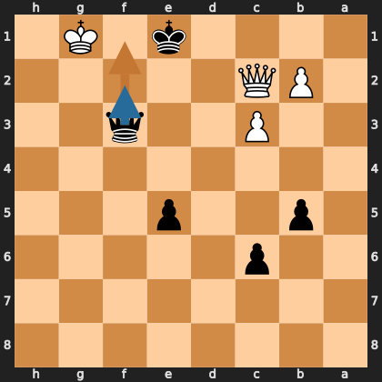

## Reproduction and saved results

The Elo configuration is in exp_elo/configs/elo.yaml. The preparation script reuses the exact neutral boards and cached engine scores, then samples the two Elo test sets with seed 0. The analysis scripts are under scripts/elo. Aggregated results, trajectory decompositions, confidence intervals and figures are saved under exp_elo/results. Raw policy arrays, game data, checkpoints and runtime logs are kept out of Git.

Run from the repository root with WC_ROOT=exp_elo and WC_CONFIG=elo. Use scripts/elo/prepare.py, the shared scripts/18b_style_policy.py and scripts/18c_style_engine.py, and scripts/19_rollouts.py. Then run scripts/elo/analyze.py, scripts/elo/quality.py, scripts/elo/rollout_summary.py and scripts/elo/matched_kl.py. The cross-domain launcher documents the exact checkpoint schedule. The original training and sweep launchers are included in this branch.
